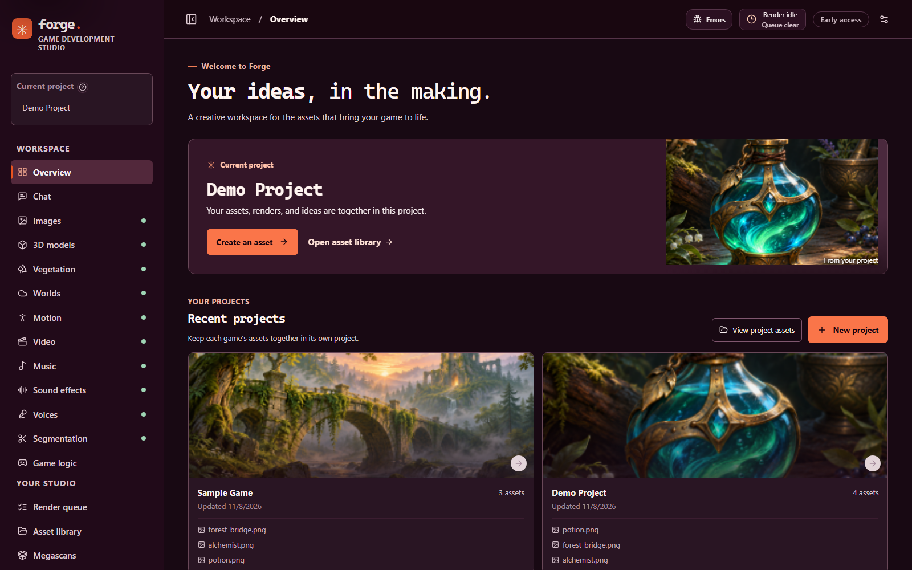
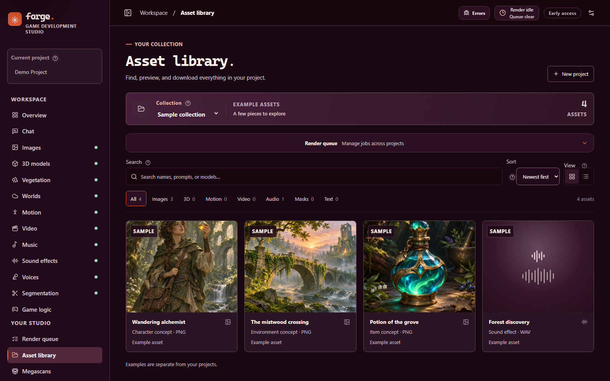
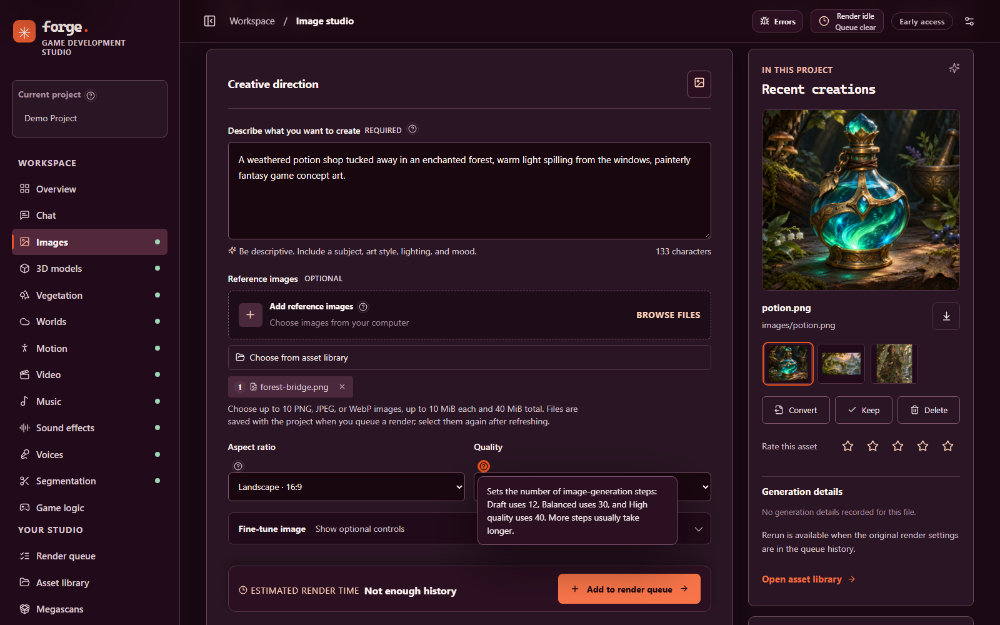
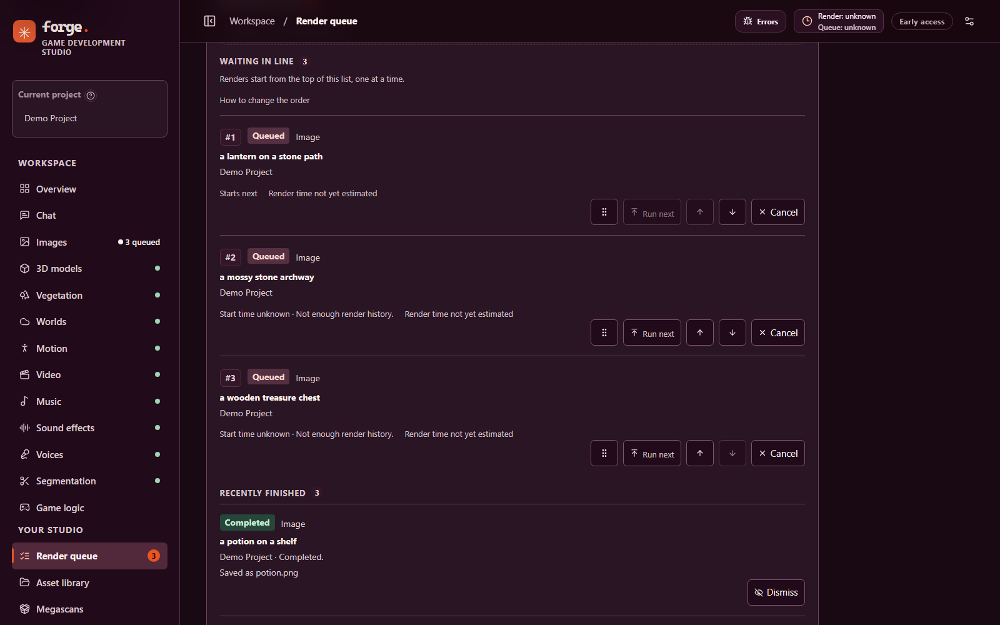
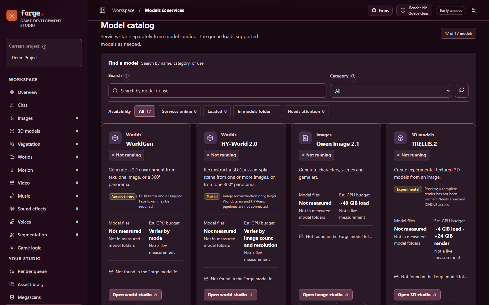

# Forge — Game Development Studio

**Create, organize and iterate on game assets in one local studio.**


Forge brings image, music, sound, video, voice, 3D, world and motion workflows
into a React interface backed by a durable render queue. Keep each game's
assets together, inspect local engine health, and connect agents through HTTP
and MCP.



_The Forge overview with two demo projects and the bundled sample artwork._

Forge is an early-stage integration project. The app and queue can start without
model weights, but rendering requires separately installed models, native
engines and, for some adapters, companion applications. A fresh clone is **not**
a complete one-command AI environment. The existing local setup targets native
Windows ARM64 and NVIDIA GPU inference; other platforms and hardware have not
been validated to the same level.

[Get started](#get-started) · [Capabilities](#capabilities) ·
[Models and engines](#models-and-engines) · [API and MCP](#api-and-mcp) ·
[Development](#development) · [Documentation](#documentation)

[Project site](https://monstercameron.github.io/Game-Development-Studio/)

## Built on NVIDIA RTX Spark

Forge is developed and tested on an **NVIDIA RTX Spark N1X** system: a Blackwell
GPU with 6,144 cores and 96 GB of GPU memory (98,304 MiB as reported by the
driver), running Windows 11 on ARM64 natively, with no WSL and no CPU inference.
That one-machine setup is where every "tested" status in these docs was
measured, and its memory limits shape how Forge loads models one at a time. Other
hardware has not been validated to the same level.

_NVIDIA, RTX and RTX Spark are trademarks of NVIDIA Corporation. Forge is an
independent project and is not affiliated with, sponsored by or endorsed by
NVIDIA._

## Get started

### Requirements

- Node.js 24 or later and npm, on Windows for the supported local setup.
- An NVIDIA GPU and compatible drivers for local model inference. Memory and
  storage needs depend on the model and selected settings.
- Model weights, native runtimes, credentials and any required companion apps,
  installed separately. Some model repositories require access approval.

See the [installation guide](docs/INSTALLATION.md) before setting up model
engines. It covers prerequisite checks, staged downloads and what still requires
manual installation. Model origins and licenses are in the
[model source guide](docs/MODEL_SOURCES.md).

### Install and launch

From PowerShell in the cloned repository:

```powershell
npm ci
npm run build
powershell -NoProfile -ExecutionPolicy Bypass -File .\start-server.ps1
```

Open [http://127.0.0.1:5173](http://127.0.0.1:5173). To open the Windows
desktop window instead, run `start-desktop.cmd` after the build. The desktop
window uses the same local Studio service and its Windows notification-area
controls. To stop the service, run:

```powershell
powershell -NoProfile -ExecutionPolicy Bypass -File .\stop-server.ps1
```

The launcher does not load model weights just by starting the Studio. Engines
can start or load when requested, subject to their configuration and memory
checks. To inspect local prerequisites without downloading anything:

```powershell
powershell -NoProfile -ExecutionPolicy Bypass -File .\install.ps1 -CheckOnly
powershell -NoProfile -ExecutionPolicy Bypass -File .\install.ps1 -ListModels
```

Shell launchers are also included, but macOS and Linux model integration has
not been verified end to end. See [installation](docs/INSTALLATION.md) for
platform details and alternate ports.

## Capabilities

- **Projects and assets:** create project folders; search, filter, preview,
  download, rename, rate and keep assets. Deleted project assets go to
  recoverable trash until it is cleared.
- **Creation panels:** queue supported image, audio, video, speech, segmentation,
  shape, motion and world jobs. Select compatible project assets as inputs and
  iterate on supported results.
- **One render queue:** sequential jobs persist across restarts; uncertain
  submissions pause for review. Estimates reflect available history and can be
  unknown or approximate.
- **Engine control and diagnostics:** see service status, model storage and
  memory estimates, request supported idle offloads, inspect logs, and copy
  errors. Engines are isolated from the Studio host where supported.
- **Desktop and notifications:** use the Windows tray to control the desktop
  window, offload eligible idle models and receive queue notifications. Browser
  notifications and a keep-awake option are also available.
- **Chat and game logic:** chat with the local Qwen server or a configured
  compatible provider, request structured output, and use the Mammoth decision
  bridge for supported game-logic requests.

### Screenshots

These were captured from the current build, running in an isolated copy of the
Studio with no engines connected and no model files installed. The projects,
artwork and queue rows are demo content built from the bundled samples; none of
it was rendered by a model.



_Search, filter and preview assets in the library; the screenshot shows the bundled sample collection._



_Create images with project context and a reference image. Field help opens inline, and the estimate bar reports "Not enough history" until the project has completed renders to compare._



_The render queue lists waiting renders in order, with controls to reorder or cancel each one, above recently finished renders. The rows are demo entries; no engine was running, so nothing was rendered._



_The Models and services catalog on a source checkout with no model weights installed: every card reports its model files as not found, with the estimated GPU budget and any access or preview notes. Installing models is covered in the [installation guide](docs/INSTALLATION.md)._

## Models and engines

| Workspace               | Integrated models or services                    | Notes                                                                                                                                       |
| ----------------------- | ------------------------------------------------ | ------------------------------------------------------------------------------------------------------------------------------------------- |
| Images                  | Qwen Image 2.1                                   | Local image generation and supported image references.                                                                                      |
| Music and sound         | YuE2, Stable Audio 3                             | Stable Audio is gated and requires approved access.                                                                                         |
| Voice                   | Qwen3-TTS, NVIDIA Nemotron Speech Streaming      | TTS uses preset voices; speech recognition supports realtime and file workflows.                                                            |
| Video                   | MiniMax H3 Ref2VA                                | Uses the separately installed H3 application and native renderer.                                                                           |
| 3D and worlds           | Hunyuan3D 2.1, TRELLIS.2, WorldGen, HY-World 2.0 | TRELLIS.2 remains experimental; a complete render has not been verified. World output may need cleanup before use in a game.                |
| Segmentation and motion | SAM 3.1, HY-Motion 1.0, NVIDIA MotionBricks      | Motion workflows are experimental and do not provide automatic character rigging or retargeting.                                            |
| Chat and game logic     | Qwen3.8-27B, Mammoth-1, compatible chat APIs     | Local chat uses a native CUDA llama.cpp server; MTP speculative decoding is configurable but needs verification on the target installation. |

Availability varies by model, platform, installed dependencies and granted
access. A present file or reachable service does not establish a working GPU
render. The [model source guide](docs/MODEL_SOURCES.md) records sources,
restore steps, compatibility work and known verification limits.

## Data and model storage

The Studio uses `models/` for local model files and `projects/` for project
assets. `.forge-runtime/` holds runtime state, logs and the durable queue.
These directories, installed dependencies and native binaries are ignored by
Git. Back up projects and any needed runtime state separately from the source
repository. Some standalone apps use compatibility links to the same model
files; shared models are protected from Studio removal when their consumers
cannot yet be safely coordinated.

On Windows, API keys saved through Studio settings are encrypted with the
current user's Windows Data Protection API before storage in a local SQLite
database. Saved keys are not returned to the browser. See the
[studio guide](docs/STUDIO_GUIDE.md#api-keys) for credential and fallback
behavior. The local server binds to loopback by default; review the security
implications before exposing it to another machine.

## API and MCP

Forge provides local HTTP APIs and MCP tools for model discovery, project and
asset operations, queue control, and supported creation workflows. For example,
`GET /api/models` returns the model catalog. With the Studio service running,
the MCP bridge can also be started over stdio:

```powershell
npm run mcp
```

See the [MCP guide](docs/MCP.md) for connection details, available controls and
the protocol version. API calls and tests using substitute workers do not prove
that a real model can render on a particular machine.

## Development

```powershell
npm ci
npm run dev                 # Vite development server
npm test                    # JavaScript tests
npm run build               # Production frontend build
npm run lint                # ESLint
npm run format:check        # Prettier
```

Python checks use a separate development environment; see the
[code quality guide](docs/CODE_QUALITY.md). Existing repository-wide lint and
formatting debt is documented there. The [test guide](test/README.md) explains
which checks use isolated workers and which load real GPU models. Follow
[AGENTS.md](AGENTS.md) when changing the project.

## Documentation

- [Installation and model prerequisites](docs/INSTALLATION.md)
- [Model sources, downloads and licensing](docs/MODEL_SOURCES.md)
- [Studio operations and detailed local setup notes](docs/STUDIO_GUIDE.md)
- [MCP and agent controls](docs/MCP.md)
- [Agent setup](docs/AGENT_SETUP.md) and [runtime map](runtime/README.md)
- [Windows ARM64 build notes](docs/WINDOWS_ARM64.md) and [tests](test/README.md)
- [Private remote access with Tailscale and SSH](docs/TAILSCALE_REMOTE.md)

## License

Forge source code is available under the [MIT License](LICENSE). Model weights,
companion applications, third-party dependencies and their example assets have
their own licenses and access terms; the MIT license does not replace them.
